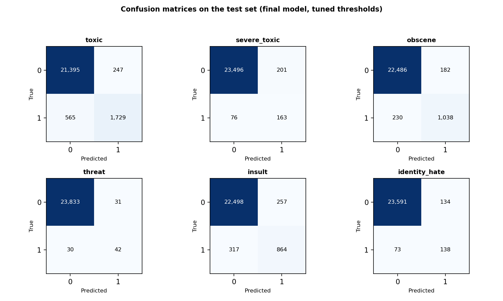

# Anti Hater Filter: multi-label classification with recurrent networks

Multi-label classifier that flags six kinds of toxicity in online comments (toxic, severe toxic, obscene,
threat, insult, identity hate). A regularised bidirectional GRU on frozen FastText embeddings reaches
**macro-F1 0.68 and macro ROC-AUC 0.99** on a held-out test set, against 0.63 and 0.98 for a
TF-IDF + Logistic Regression baseline tuned in the same way.

**Stack**: Python, TensorFlow/Keras, scikit-learn, pandas.


## Results (test set, 23,936 comments)

| Model | Macro-F1 | Micro-F1 | ROC-AUC | PR-AUC | Hamming loss | Subset accuracy |
|---|---|---|---|---|---|---|
| **BiGRU, per-label thresholds** | **0.681** | **0.772** | **0.988** | **0.714** | **0.0163** | **0.924** |
| TF-IDF + LR, threshold 0.5 | 0.566 | 0.681 | 0.981 | 0.650 | 0.0295 | 0.880 |
| TF-IDF + LR, per-label thresholds | 0.626 | 0.729 | 0.981 | 0.650 | 0.0205 | 0.908 |

Per label (final model):

| Label | Positives in test | Precision | Recall | F1 | ROC-AUC | PR-AUC |
|---|---|---|---|---|---|---|
| toxic | 2,294 | 0.875 | 0.754 | 0.810 | 0.981 | 0.898 |
| severe_toxic | 239 | 0.448 | 0.682 | 0.541 | 0.991 | 0.482 |
| obscene | 1,268 | 0.851 | 0.819 | 0.834 | 0.989 | 0.908 |
| threat | 72 | 0.575 | 0.583 | 0.579 | 0.995 | 0.580 |
| insult | 1,181 | 0.771 | 0.732 | 0.751 | 0.986 | 0.822 |
| identity_hate | 211 | 0.507 | 0.654 | 0.571 | 0.985 | 0.594 |



How to read it: thresholds are chosen per label on the validation set, for both the final model and the
baseline, so the comparison is like for like. The gain over the tuned baseline is +5.5 points of macro-F1
(+13 points on identity_hate). Rare labels have few positives in the test set (72 threats), so their
F1 is noisy.

## Context

Online platforms receive more harmful comments than moderators can review by hand. The task was to build a model with recurrent layers that assigns each comment any of six toxicity labels
(or none), so that moderation can be automated. The original brief is at the end of this file.


## Approach

1. **Data and split**: about 160k comments, 89% with no label; the three rarest labels are under 1%.
   Multi-label stratified split 70/15/15 (seed 42).
2. **Cleaning**: Unicode, HTML entities, URLs, mentions, hashtags, e-mails, contractions, emoji,
   repeated characters and punctuation.
3. **Embeddings**: pre-trained FastText crawl-300d-2M, frozen. Vocabulary of 20,000 tokens and sequences
   of 200 tokens (over 95% of the comments are shorter). FastText was preferred to GloVe Twitter for its
   slightly higher vocabulary coverage.
4. **Baseline**: TF-IDF (50k features, 1-2-grams) + Logistic Regression with balanced class weights.
5. **Models**: 11 LSTM/GRU variants (uni/bidirectional, weighted loss, dropout, size) compared on the
   validation set. Weighted losses raised the Hamming loss and were dropped. The two finalists, regularised
   BiLSTM and BiGRU, went through threshold tuning: validation macro-F1 0.669 vs 0.680, so the BiGRU was
   chosen.
6. **Final model**: BiGRU with 64 units, dropout 0.2 / 0.2 / 0.3, 141k trainable parameters plus 6.0M
   frozen embedding weights, 13 epochs (about 65 minutes on my machine). Thresholds: 0.25 for severe_toxic,
   0.30 for threat, 0.15 for identity_hate, 0.5 for the others.

## Reproduce

Quick check (minutes): evaluates the saved model on the test set and refits the baseline.

```bash
pip install -r requirements.txt
python evaluate_final_model.py
```

It prints the metrics above, writes `results/test_metrics.json`, `.csv`, `.md` and the confusion
matrices, and checks that the macro-F1 matches the one in the notebook. Use `--skip-baseline` to
evaluate only the final model. The saved weights already contain the embeddings, so FastText is not needed.
Run it from this folder.

Full run: open `anti-hater-filter.ipynb` from this folder. It downloads GloVe Twitter and FastText
(several GB) and trains all the models, which takes hours (about 8 hours of logged training time for the 11 models, on my machine).

## Repository

| File | Content |
|---|---|
| `anti-hater-filter.ipynb` | full experiment: EDA, preprocessing, baseline, 11 models, threshold tuning, test |
| `evaluate_final_model.py` | reproduces the test-set results from the saved model |
| `models/model_10_BiGRU_Reg_weights.h5` | weights of the final model |
| `hate_speech_vocabulary.pkl` | vocabulary used by the model |
| `results/` | test metrics, confusion matrices, validation comparison of all models |
| `requirements.txt` | pinned dependencies (Python 3.12) |

## Limitations

- One split, one seed, no confidence intervals; the rare labels rest on few examples.
- Thresholds are tuned on one validation set and not cross-validated.


<details> 
<summary>Original brief</summary>

## The Problem to Solve

The company **TechTalk**, a forum for technology enthusiasts, has found that a significant number of comments posted in community threads contain hate speech and insults that compromise the quality of discussions. Users have reported that, due to its growing popularity, the platform struggles to manage the flow of harmful comments using traditional moderation tools. **TechTalk** has turned to **DeepCortex AI Solutions** to implement an automated moderation solution based on Deep Learning that can filter toxic comments in real-time.
**DeepCortex AI Solutions** has decided to develop an advanced system based on Deep Learning technologies to automate and improve the moderation process. At the heart of the project is a deep learning model featuring **recurrent layers**, designed to classify comments into multiple toxicity categories.

### Use Case

**Real-world scenario:** Mario Rossi, community manager at TechTalk, handles the manual moderation of user-generated content daily. With the increase in platform traffic, Mario can no longer manually manage the volume of harmful comments and must find a way to automatically filter offensive, threatening, or obscene comments without slowing down the user experience.

---

### Technical Model Requirements

* **Task:** Multi-label classification of comments into 6 categories:
1. Toxic
2. Severely Toxic
3. Obscene
4. Threat
5. Insult
6. Identity Hate


* **Dataset:** A dataset of 160,000 comments will be provided, with each comment labeled in one or more of the categories above. Comments may have zero or more active labels.
* **Architecture:** The model must include **recurrent layers** (e.g., LSTM or GRU) to handle the sequential nature of textual comments.
* **Output:** At the inference level, for each comment, the model must produce a vector of 6 elements (one for each label) with binary values (0 or 1), where 1 indicates the presence of the corresponding label and 0 its absence.

---

### 1. Data Preprocessing

* Textual comments must be converted into numerical sequences (tokenization).
* Data must be normalized and balanced to ensure all toxicity categories are represented fairly.

### 2. Model Development

* The deep learning model will be based on a recurrent architecture capable of capturing long-term dependencies between words in comments.
* Recurrent layers (LSTM or GRU) will be implemented for the multi-label classification task.

### 3. Model Training

* The dataset will be split into training, validation, and test sets.
* Advanced optimization techniques will be used to improve model convergence.

### 4. Inference and Prediction

* During inference time, for each comment, the model will return a 6-element vector of 0s or 1s, depending on the presence of toxicity in one or more of the predicted categories.

### 5. Validation

* The model will be evaluated using metrics such as **Accuracy**, **F1-score** for each category, and **Global Precision** in predicting multiple labels.

---

### Added Value

* **Automation:** The model will significantly reduce the manual moderation workload, allowing TechTalk to handle a larger number of comments in real-time while maintaining a safe environment for users.
* **Efficiency:** By using recurrent layers, the model will better capture the context and nuances of textual comments, improving prediction accuracy compared to traditional methods.
* **Scalability:** Once implemented, the system will be easily scalable to handle growing volumes of data, adapting to the increasing number of users and comments on the platform.
* **Integration:** The solution will be integrated directly into TechTalk's commenting system, making automatic filtering immediately operational without negatively impacting user experience.

### Dataset

The dataset can be downloaded from this link:

[Filter_Toxic_Comments_dataset.csv](https://proai-datasets.s3.eu-west-3.amazonaws.com/Filter_Toxic_Comments_dataset.csv)

</details>